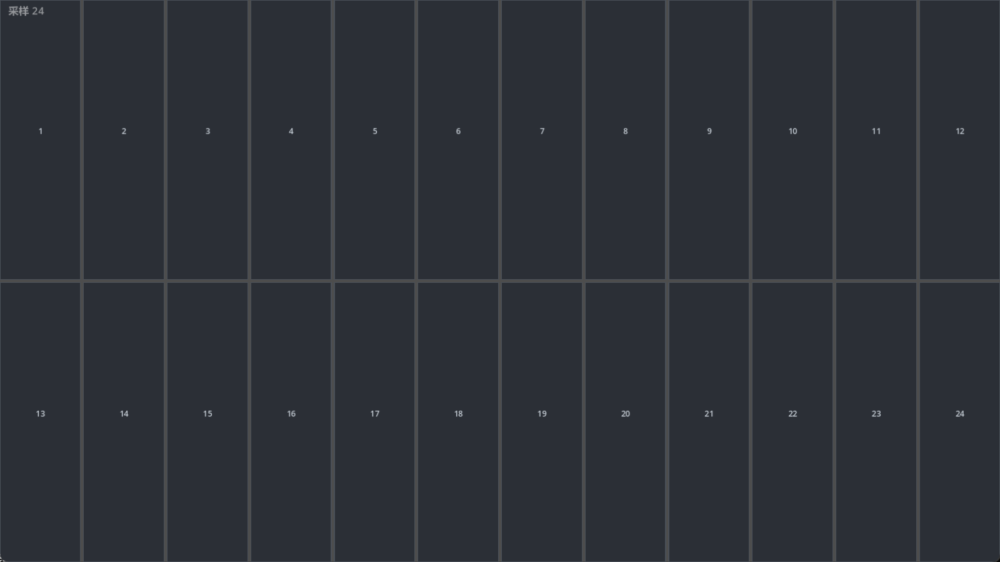

# du乐器
嘟嘟嘟嘟
纯ai制作，音频拿melodyne调的
感谢b站@肘击王结成友奈 提供的采样包
只有apk
下载：https://github.com/Korolensoul/DU-MUSIC/releases/tag/26.11.9
剩下的话全是ai写的
一个给安卓手机用的 **24 键音效键盘**：横屏两排铺满整块屏幕，手指按哪个格子就响哪个采样，支持多点触控、滑键和「按得靠下更响」的力度。

用 **Godot 4.7 + GDScript** 写的，没有 .NET / Mono 依赖，装好的 APK 只有 **28 MB**，冷启动一两秒，低端机也能跑。



---

## 它是干什么的

不是钢琴教学软件，也不是 MIDI 合成器，就是一个**把采样当琴键敲的音板**：

- 你准备 24 段自己的音效（鼓、人声、乐器、音效素材都行）
- 按顺序命名丢进 `audio/` 目录
- 打开 App，点格子就出声

适合做打击垫、音效板、简易采样器、舞台/直播用的触发键盘。

---

## 功能

| 功能 | 说明 |
| --- | --- |
| 等宽网格 | 默认 12 列 × 2 行 = 24 格，行数按音的数量自动算，任意横屏分辨率都铺满 |
| 多点触控 | 每根手指独立跟格，10 指同时按也不会互相打断 |
| 滑键 | 手指滑过相邻格子，先松开旧音再触发新音，不会卡音 |
| 力度 | 按在格子下部 = 重（1.0），上部 = 轻（0.4），用纵向位置模拟力度 |
| 32 路复音 | 播放器全忙时轮转抢占最早的那路，连点不会哑 |
| 防爆音 | Master 总线挂了 `AudioEffectHardLimiter`，上限 −0.5 dB |
| 自动松键 | 切后台、来电、失焦时全部停音，回来不会「挂音」 |
| 诊断 HUD | 左上角小字 `采样 24 · 键 3`，一眼看出是采样没加载还是触摸没进来 |
| 横屏锁定 | 导出时锁定 landscape，并保持屏幕常亮 |

---

## 下载安装

APK 在 [Releases](../../releases) 里，文件名 `du.apk`。

- 系统要求：Android 7.0（API 24）及以上
- 架构：**arm64-v8a**（2017 年之后的手机基本都是）
- 安装时若提示「未知来源」，在系统设置里允许一次即可
- 首次启动黑屏一两秒是正常的（引擎初始化 + 加载 24 个采样）

---

## 使用

1. 横屏打开，屏幕上就是 24 个格子，编号 1–24 对应 `00.wav`–`23.wav`
2. 单指点按 = 触发一次；按住不放会等采样自然放完
3. 多指同时按 = 同时触发多个音
4. 想要更响，按格子的下半部分

左上角 HUD：

- `采样 24` = 24 个音频都加载好了
- `采样 24 · 键 3` = 最后一个触发的是第 3 格
- 如果显示 `采样 0`，说明 `audio/` 目录没被正确打包，看下面的排查

---

## 从源码运行

需要 **Godot 4.7**（标准版即可，**不要**用 .NET/Mono 版）：

1. 下载 Godot 4.7，解压运行
2. 打开本目录下的 `project.godot`
3. 按 F5 运行

桌面端用鼠标也能测试：点一下就是一个音，拖动就是滑键。

---

## 换成你自己的声音

### 命名规则

```
audio/
├── 00.wav   ← 第 1 格（左上角）
├── 01.wav   ← 第 2 格
├── ...
└── 23.wav   ← 第 24 格（右下角）
```

- 文件名开头的数字就是键位，**按数字排序**，不是按字母
- 数字补零到两位（`00`–`23`），超过 100 个可以补三位
- 数量随意，程序启动时扫描目录，有几段就画几格，列数固定 12，行数自动算
- 支持 `.wav` / `.ogg` / `.mp3`

### 采样建议

当前自带的 24 段是 44.1 kHz / 24-bit / 立体声、每段约 0.27 秒的短音。换素材时建议：

- 时长 0.1–1 秒之间，太短听不清、太长会糊在一起
- 开头把静音裁掉，否则会有「按下去延迟」的错觉
- 峰值统一到 −1 dB 左右，避免个别音爆音
- 文件名不要带空格和中文，省得脚本/打包出岔子

### 换完要做的事

把新文件放进 `audio/` 后，在 Godot 编辑器里打开项目，它会自动重新导入；导出的 APK 才会带上新采样。

---

## 导出安卓 APK

前提：装好 Android SDK（platform-tools / build-tools / platforms）和 JDK 17，并在
`编辑器设置 → 导出 → Android` 里填好 `Java SDK Path` 和 `Android SDK Path`。

导出预设里这几个开关是必须的，缺一个都会导出失败或装不上：

| 设置 | 值 | 原因 |
| --- | --- | --- |
| Gradle Build → Use Gradle Build | **关闭** | 走预编译模板，不需要联网拉 AGP |
| Architectures → arm64-v8a | **开** | 覆盖 99% 的手机 |
| Texture Compression → ETC2/ASTC | **开** | 项目设置 `rendering/textures/vram_compression/import_etc2_astc` |
| Screen → Orientation | `landscape` | 横屏 |

命令行导出（不开编辑器）：

```bash
godot --headless --path . --export-debug "Android" build/du.apk
```

---

## 可调参数

在场景里选中 `KeyboardView` 节点，检查器里能直接改：

| 参数 | 默认 | 说明 |
| --- | --- | --- |
| `Columns` | 12 | 每行几格 |
| `Key Count` | 24 | 总格数（启动后会被实际音频数量覆盖） |
| `Gap` | 6 | 格子间距（像素） |
| `Padding` | 0 | 四周留白 |
| `Idle Color` | `#2b2f36` | 未按下的格子底色 |
| `Border Color` | `#4a5058` | 格子边框色 |
| `Active Color` | `#4c9aff` | 按下高亮色 |
| `Text Color` | `#c9d1d9` | 格子编号颜色 |

---

## 项目结构

```
.
├── project.godot          工程配置（1920×1080 视口，GL Compatibility 渲染器）
├── main.tscn              主场景：Main → KeyboardView + AudioEngine + HUD
├── main.gd                接线：读采样数、更新 HUD、切后台松键
├── grid_layout.gd         纯计算：矩形切网格、坐标 → 格子编号
├── keyboard_view.gd       画格子、收触摸/鼠标、发 key_down / key_up 信号
├── audio_engine.gd        32 路播放器池、按文件名排序加载采样、限幅
├── audio/                 24 段采样（00.wav – 23.wav）
├── icon.png               应用图标
├── export_presets.cfg     安卓导出预设
└── screenshot.png         截图
```

代码一共不到 300 行，逻辑分三层：几何计算（`grid_layout.gd`）不碰渲染，
输入和绘制（`keyboard_view.gd`）不碰音频，发声（`audio_engine.gd`）不碰 UI。
想加功能基本都能找到唯一该改的地方。

---

## 常见问题

**按了没反应？**
先看 HUD。显示 `采样 24` 但编号不变 → 触摸事件没进来；编号变了但没声音 → 音频设备/采样问题。

**装好后闪退？**
多半是架构不对。这个包只带 arm64-v8a，老设备或者模拟器（x86_64）需要自己重新导出勾上对应架构。

**声音延迟大？**
这是 Godot 的音频后端决定的，安卓上大约 35–60 ms。要更低的延迟得上原生 Oboe/AAudio 重写，不是 GDScript 能解决的。

**能不能竖屏？**
可以，把 `project.godot` 里的 `window/handheld/orientation` 改成 `1`（portrait），
再把 `Columns` 调小到 4 或 6，否则格子会细得像筷子。

---

## 许可

MIT，见 [LICENSE](LICENSE)。音频素材如无特别说明随项目一同发布。
